[](https://linnnn102.github.io/)
[](https://linkedin.com/in/linnnnj)

M.S. Computer Software Engineering at Northeastern University, in Boston. I build systems where the model is one component and the engineering around it does the rest: local LLM pipelines, agentic tool-calling, retrieval grounded in real taxonomies. Three years as a data engineer before grad school, then GPU software as a Software Developer Intern at NVIDIA. I co-authored *Ref-Adv: Exploring MLLM Visual Reasoning in Referring Expression Tasks*, accepted at ICLR 2026.

Full experience, research, and education → **[linnnn102.github.io](https://linnnn102.github.io/)**

---

[](https://github.com/linnnn102/RaGuard)

`Python` · `Ollama / Qwen3` · `RAG` · `QLoRA / Unsloth` · `Docker` · `ffuf` · `SecLists`

Finds vulnerabilities in Python web apps, then proves them over HTTP. Every model call — orchestrator, specialists, and embedder — goes to a local Ollama, so there are no requests to model providers at runtime. It is also an experiment: how much of a generalist LLM's job can a fine-tuned 1.7B specialist take over, and what does that cost you?

```
source.py ─▶ retrieve CWE/CVE ─▶ Qwen3 static analysis
          ─▶ select SecLists wordlists ─▶ ffuf ─▶ report by CWE
```

- Retrieval grounds each finding in authoritative security taxonomy: 994 chunks of CWE definitions and real CVE examples, pulled by cosine similarity over `qwen3-embedding:0.6b` vectors. The knowledge base records which model embedded it and refuses to load a mismatched one.
- An LLM orchestrator runs a tool-calling loop and routes each narrow task to a specialist SLM — `analyze_code`, `select_wordlists`, `suggest_mitigations` — following NVIDIA's *[Small Language Models are the Future of Agentic AI](https://arxiv.org/abs/2506.02153)*, including the paper's S1–S6 LLM-to-SLM conversion loop.
- That loop is implemented end to end: 11.8K logged teacher-LLM calls curated down to an 820-example corpus, QLoRA fine-tuning on a free Colab T4, merged and quantized to GGUF for local serving. Scored on precision, recall, F1, latency, and token cost, the fine-tuned 1.7B **finishes a scan in about half the 8B's time while catching 95% of what it catches** (recall 0.600 vs 0.633), and swapping it in is one line of YAML.
- Every wordlist path is validated against the SecLists catalog before it reaches the generated `fuzz.sh`, so a path the model invented can never break a run. If the model is unreachable, a static CWE→wordlist map takes over.
- `docker compose up` runs the whole pipeline in two OWASP-hardened containers: vulnerable target, fuzzing runner, parsed report. Fuzz jobs are independent — one failure is reported instead of discarding the rest.

[](https://github.com/linnnn102/Ferrite)

`Rust (no_std)` · `x86-64 Assembly / NASM` · `QEMU` · `GDB / LLDB` · `Make`

A small x86-64 operating system written from scratch: a two-stage bootloader that takes the CPU from 16-bit real mode to 64-bit long mode, and a freestanding Rust kernel. No GRUB, no `bootloader` crate, no external Rust dependencies.

```
BIOS ─▶ stage 1 @ 0x7C00 ─▶ load stage 2 + kernel via int 0x13
     ─▶ GDT, protected mode ─▶ page tables, long mode ─▶ kmain() @ 0x10000
```

- Stage 2 checks long-mode support with CPUID, builds a PML4 → PDPT → PD identity map with one 2 MiB page, then sets PAE, EFER.LME and paging and far-jumps through a 64-bit GDT into the kernel.
- The kernel is `#![no_std]`, `#![no_main]`, `panic = "abort"`, with a custom panic handler and a linker script that pins `kmain` at `0x10000`. Port I/O wraps `in`/`out` with inline `asm!`.
- The VGA text driver handles 80×25 with 16 colors, line wrapping and scrolling, volatile bounds-checked buffer writes, and hardware cursor control through the CRTC ports.
- `make run` boots it in QEMU and logs interrupts and resets; `make debug` boots paused with a GDB stub. The build fails if the kernel outgrows the sectors the bootloader loads, rather than booting a truncated image.

[](https://github.com/linnnn102/IntelligentBistro)

`TypeScript` · `Expo / React Native` · `NativeWind` · `Zustand` · `Node / Express` · `Gemini API` · `Zod`

A restaurant app where the customer browses the menu with the usual `+`/`−`/remove controls, or just says what they want and watches the cart change.

```
"Add two spicy chicken sandwiches and a large water"
   └─▶ add_item ×2 · add_item(size: large)  ─▶  cart updates instantly
```

- Gemini function calling drives four constrained tools (add, update, remove, clear). Every tool call is validated with Zod before it reaches the cart, so malformed model output changes nothing.
- The cart lives entirely in the app as Zustand state; the backend stays a thin menu server and AI proxy that passes the current cart and menu as system context.
- Runs on iOS, Android, and web. On a physical device the app discovers Metro's host and finds the backend from there.

[](https://github.com/linnnn102/jd-atlas)

`Python` · `three.js / WebGL` · `NumPy` · `GitHub Actions` · `Greenhouse / Ashby / Lever`

A 3D map of the tech stack and keyword landscape in AI/ML engineering job descriptions, rebuilt every morning from 57 public job boards. **[Live map →](https://linnnn102.github.io/jd-atlas/)**

```
57 job boards ─▶ ~500 AI/ML roles ─▶ 150-term tech taxonomy
              ─▶ MDS + co-occurrence ─▶ 3D map, rebuilt daily
```

- Only public, documented ATS APIs — no LinkedIn or Indeed scraping. One request per board returns every posting with its full description, so a complete refresh of ~8,000 postings takes about 20 seconds.
- Terms are placed by co-occurrence rather than frequency: classical MDS sets the global shape, similarity attraction pulls related tech together, and box separation guarantees none of the 124 labels overlap. Long labels separate horizontally instead of being flung out of the cloud.
- Taxonomy aliases are audited against real posting text and every false positive is locked behind a test — `alignment` was matching "cross-functional alignment on goals", `cv` the "we never ask for CV writing services" anti-fraud boilerplate, `ray` the string "AWS X-Ray".
- GitHub Actions rebuilds and redeploys daily behind a sanity gate that fails the run rather than publishing a broken map when a board changes its API. Full job-description text is never committed or published; only aggregate keyword output is.

---

## Also on the shelf

| Project | What it does | Built with |
|---|---|---|
| [placement-transfer](https://github.com/linnnn102/placement-transfer) | Attention placement transfer for hybrid architectures | Python |
| [LinkOut](https://github.com/linnnn102/LinkOut) | Job board that surfaces what others hide: visa sponsorship, reposts, agency attribution | Java 21 · Spring Boot · Hibernate · PostgreSQL |
| [Lisav](https://github.com/linnnn102/Lisav) | Work request management for organ transplants | Java |

## Toolbox

| Area | Stack |
|---|---|
| **Languages** | Python · TypeScript · Java · C · SQL |
| **AI systems** | Ollama · Qwen3 · Gemini API · RAG · LoRA · MCP |
| **Backend & data** | Node/Express · Spring Boot · Hibernate · PostgreSQL · BigQuery |
| **Infra** | Docker · Linux · Jenkins · GCP |

---

## 🐍 And, for fun

### [SnakeGame](https://github.com/linnnn102/SnakeGame) — C, SDL2, and a Makefile

```
┌──────────────────────────────┐
│  ●●●●●○                ◆     │    make check && make && ./snake
└──────────────────────────────┘
```

Classic snake in a real window. WASD or arrow keys to steer, space to start, ESC to quit. `make check` tells you which SDL2 libraries you're missing before you try to build.
